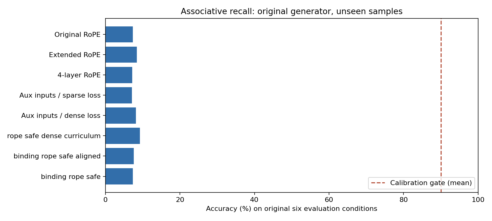
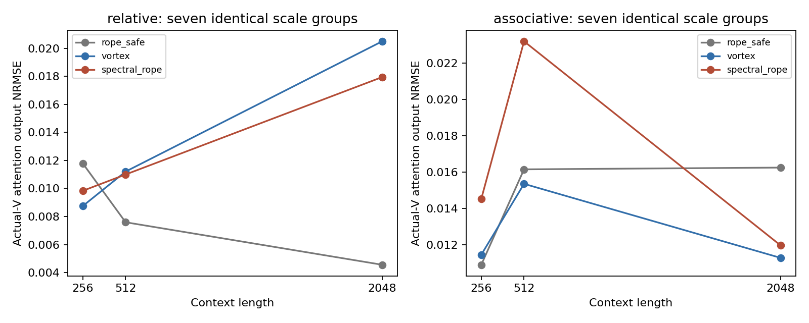

# VortexHash 补充诊断与优化

本轮单独保存于 `vortex_followup/`，原始实验与结论未覆盖。位置算子、频谱、模型结构均保持原样。

## 找到了什么

旧模型没有建立可靠的按 key 检索。删除 query 的诊断之外，本轮还把末尾 query 换成上下文中另一个确有绑定、答案不同的有效 key，观察输出是否跟随改变。这个反事实包含部分重复绑定；主准确率仍采用原始生成器。

| checkpoint | 原 query 准确率 | 换 key 后准确率 | 预测答案不变比例 | 概率分布平均变化 TV |
|---|---:|---:|---:|---:|
| p2_associative_rope_safe_s2026 | 8.59% | 6.64% | 54.88% | 7.90% |
| p2b_associative_rope_safe_s2026 | 6.64% | 6.84% | 75.39% | 2.04% |
| p2b_associative_vortex_s2026 | 7.81% | 6.45% | 88.28% | 1.00% |
| supervision_rope_safe_dense_curriculum_s2026 | 8.59% | 9.57% | 88.09% | 1.58% |
| supervision_rope_safe_dense_s2026 | 8.79% | 12.89% | 82.62% | 2.23% |
| supervision_rope_safe_sparse_s2026 | 7.23% | 7.23% | 81.05% | 2.82% |
| binding_rope_safe_s2026 | 7.81% | 7.81% | 84.18% | 1.75% |
| binding_rope_safe_aligned_s2026 | 8.40% | 6.64% | 71.88% | 3.73% |

因此，旧检索结果主要反映尚未学会任务，不能据此判定 Vortex 的表达能力比 RoPE 弱。稀疏监督和多步配对学习是候选原因；本轮优化实验检验其作用，没有把候选原因写成已证实的唯一根因。

## 训练优化的实测结果

在同一原始样本的 filler 位置加入 7 个辅助 query，答案只作为标签、不进入输入。一组监督末尾答案，另一组监督全部 8 个答案；配对输入 SHA256、token 预算与模型配置完全相同。辅助 query 的 key 从其之前已有的绑定中抽取，因此辅助任务平均更靠近、更早的内容，存在比末尾检索更容易的情况。

输入 SHA256：`59b3413154673b55a7ca495adc3cc553c9fdf8244a65b7eb13e4b2b0e5afc1e2`。每组 61.44M tokens；监督答案数分别为 192,000 和 1,536,000。

| 实验 | 六条件平均准确率 | 最差条件 | 平均 NLL | 训练 tokens |
|---|---:|---:|---:|---:|
| Original RoPE | 7.36% | 5.86% | 3.3655 | 61,440,000 |
| Extended RoPE | 8.46% | 5.86% | 3.1365 | 307,200,000 |
| 4-layer RoPE | 7.23% | 5.08% | 3.3252 | 61,440,000 |
| Aux inputs / sparse loss | 7.10% | 6.25% | 3.3915 | 61,440,000 |
| Aux inputs / dense loss | 8.20% | 6.64% | 2.6156 | 61,440,000 |
| rope safe dense curriculum | 9.24% | 5.47% | 2.5959 | 39,936,000 |
| binding rope safe aligned | 7.62% | 6.25% | 3.4132 | 61,440,000 |
| binding rope safe | 7.36% | 4.69% | 3.3792 | 61,440,000 |

六条件为原始生成器的长度 256/512 × 距离 8/32/128，每条件 256 个未见样本。额外保存了 1024/2048 和 1333/1334/1335，以及 INT4 per-head/group16 结果，见 `RESULTS.csv`。

短序列课程方案固定为 3000 步长度 64、3000 步长度 128、最后 6000 步回到原始 256/512 调度，共 39.936M tokens，模型、优化器、学习率调度不变。它同时改变了训练长度分布，不能把其结果单独归因为监督密度。

RoPE 最终校准：均值 9.24%，最差 5.47%；门槛为均值≥90%、最差≥80%。

该方案未通过门槛，因此没有为 Vortex/ring_plain 扩大训练；检索质量比较仍未解决。密集监督降低训练 loss 或测试 NLL，不能替代检索准确率。

### 单独的相邻绑定辅助目标

在密集监督及课程实验之后，另冻结 `BINDING_PLAN.json`：对第一层 value 位置的表示，用已有 norm 和 tied output head 恢复前一个 key。训练 loss 为末尾检索 CE + 0.25 × 相邻 key 恢复 CE。模型参数、推理图、输入及最终答案均不变；训练输入/标签摘要与原始 P2 完全相同。它是事后诊断指导的新实验，单独保留，不能当作先前假设的事前确认。

该辅助方案的 RoPE 原任务均值 7.36%、最差 4.69%。未通过检索门槛，没有扩大另两种方法的训练。

随后针对第一层共享解码器对 query key 的低恢复率，单独冻结 `ALIGNMENT_PLAN.json`：仍用 0.25 辅助权重，额外让所有 key token 位置（含末端 query）恢复自身 key，保留 value 位置的前一个 key 目标；其余数据、模型和预算不变。

对齐方案 RoPE 六条件均值 7.62%、最差 6.25%。仍未通过检索门槛，没有扩大另两种方法的训练。

| 第一层表示检查 | 长度 | 相邻绑定 key 恢复 | query key 恢复（限制 key 词表） | 余弦检索 value 准确率 | 第二层目标 value 平均 attention 权重 |
|---|---:|---:|---:|---:|---:|
| binding_rope_safe_s2026_final | 256 | 100.00% | 3.91% | 8.98% | 2.72% |
| binding_rope_safe_s2026_final | 512 | 100.00% | 4.30% | 9.77% | 2.97% |
| binding_rope_safe_aligned_s2026_final | 256 | 100.00% | 100.00% | 96.48% | 1.13% |
| binding_rope_safe_aligned_s2026_final | 512 | 100.00% | 100.00% | 94.92% | 1.26% |

对齐后，第一层 query key 与绑定 key 的恢复率均达到100%，仅在 value 位置中按第一层表示余弦检索可达约95%–96%，但整模型仍只有7.62%的六条件平均准确率。上游表示已有可用于匹配的信息，最终能力仍受后续 attention 利用和读取所限；本轮未用独立干预把 Q/K 路由与 V/readout 各自的影响分开，不能断言唯一根因。

这些共享解码器及原始余弦探针描述了学习到的表示，不能证明所有可能的解码器都无法从隐状态恢复信息，也不能把低恢复率直接当作不可逆的信息丢失。CPU eager 与 MUSA SDPA 的整模型末端监督梯度在实际 256/512 长度、FP32/BF16 下全部通过，数据与平台错误的证据仍未出现。

## 实现了按环分组的量化修正版

分组长度为 `[11,13,17,19,23,29,16]`，每 head 使用 7 个 FP32 尺度。每个组在原始置换下封闭，因此其绝对最大值尺度保持不变；对称量化也保持符号。这修复了连续 group16 跨环移动数值造成的交换性失效。未改变任何环或位置频率。

| 分组 | 精度 | 尺度数/head | code 一致率 | 最大反量化差 |
|---|---|---:|---:|---:|
| 128 | int4 | 1 | 100.00% | 0 |
| 128 | fp4 | 1 | 100.00% | 0 |
| 16 | int4 | 8 | 76.59% | 2.60915 |
| 16 | fp4 | 8 | 74.20% | 2.98493 |
| [11, 13, 17, 19, 23, 29, 16] | int4 | 7 | 100.00% | 0 |
| [11, 13, 17, 19, 23, 29, 16] | fp4 | 7 | 100.00% | 0 |

在完全相同的 7 个组长度、尺度预算下，比较 Vortex 与等谱旋转；以下是第一层真实末端 Q、完整 K、实际 V 的输出 NRMSE。投影后的 BF16 输入提升为 FP32 再做数值诊断，和原先 replay 的定义一致。

| checkpoint 任务 | 长度 | Vortex | 等谱旋转 | Vortex 相对误差降低 |
|---|---:|---:|---:|---:|
| relative | 256 | 0.008752 | 0.009837 | 11.02% |
| relative | 512 | 0.011207 | 0.010998 | -1.90% |
| relative | 2048 | 0.020500 | 0.017948 | -14.22% |
| associative | 256 | 0.011445 | 0.014522 | 21.19% |
| associative | 512 | 0.015353 | 0.023208 | 33.85% |
| associative | 2048 | 0.011271 | 0.011958 | 5.74% |

按环分组也已接入 decoder 的 `set_quant` 路径：给 `group` 传 `GROUPS` 即可。原有整数 128/16 分组委托原量化器，模型其余代码保持一致。现有已学会的 relative checkpoint 在长度256/512/2048 的完整两层推理中，pre/post 两种量化顺序的所有 logits 最大差均为0；这验证接入与交换性，不作为该天花板任务的质量优势。

这是变量长度组的软件模拟，不等同于原生 group16 格式。各方法在该比较中使用相同的 7 个组及尺度数；与原 group16 的 8 尺度、per-head 的 1 尺度结果另列。修复交换性不保证 attention 误差或整模型准确率改善，数值结果须逐项阅读。没有测试原生低比特速度或真实文本质量。

## 可复现性与结论边界

本轮新增设备占用 2116.5 秒（0.5879 h），包含活跃阶段 Python、数据生成和评估开销；加上原实验累计 2.6198 h，低于 36 h 上限。等待依赖阶段的调度进程不分配 GPU。

审计 17/17 项通过，见 `AUDIT.json`。计划、门槛、每步曲线、逐条件测试和最终 checkpoint 均保留。训练优化是有限尝试；未用低 loss 冒充已学会检索。原始论文方向仍需可靠下游任务和真实文本证据，不能升级为 GO。

运行方法见 `../README.md`。完整数值见 `RESULTS.csv`、`../results/raw/ring_groups.json`、`../results/raw/query_swap.json`。
