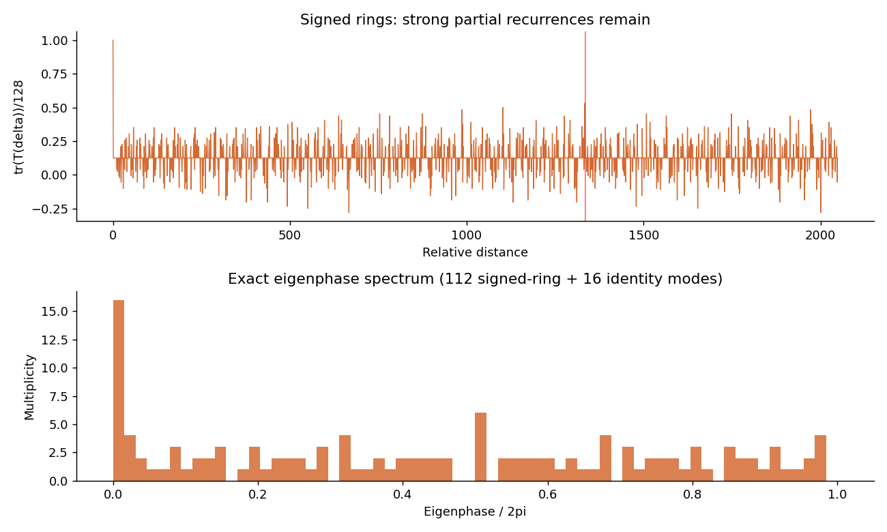
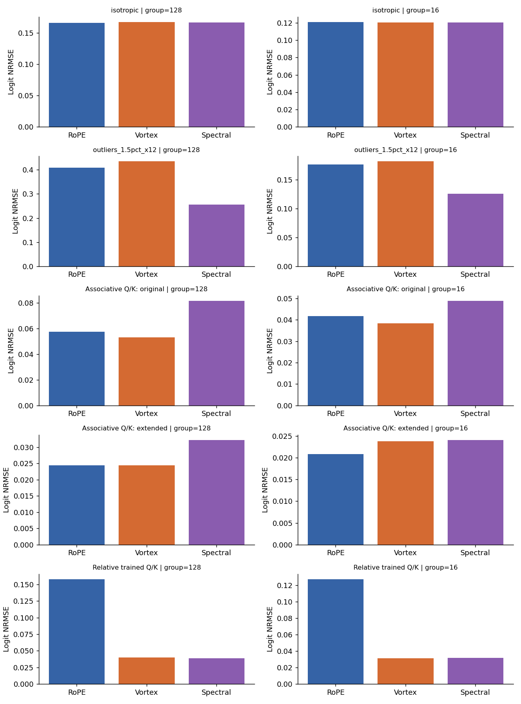
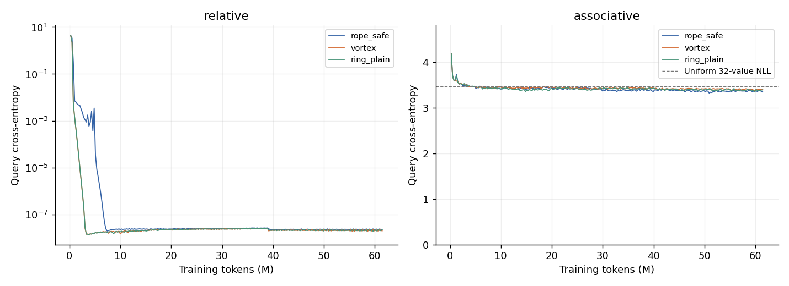
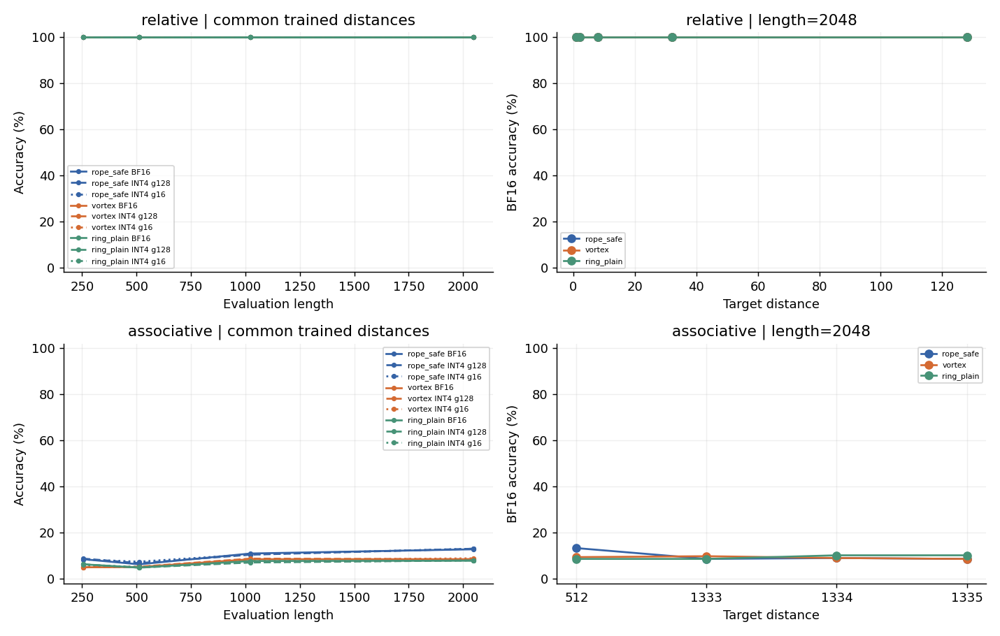
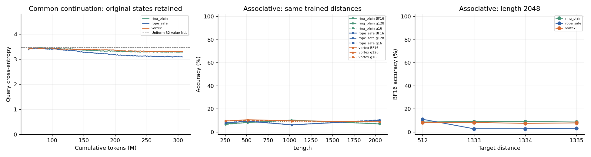
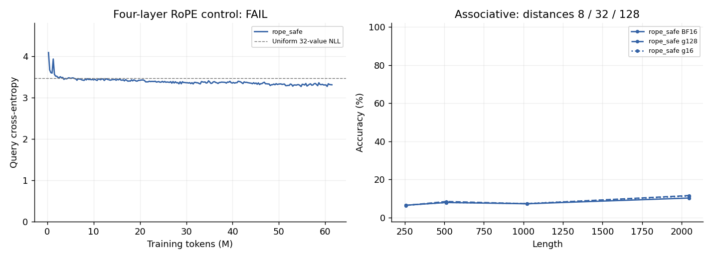
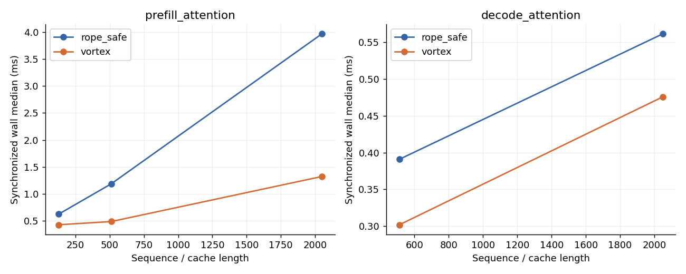

# VortexHash：MTT S4000 可行性预实验报告

## 研究问题

在语言建模能力尚未验证的前提下，先检验带符号置换的量化交换律是否转化为 attention 误差和可学习任务上的实质收益。区分精确置换、频谱差异和量化坐标系差异。所有结果均来自单张 MTT S4000；4-bit 均为软件模拟。

## 方法与基线

固定 Route A，head_dim=128，反周期环 `[11,13,17,19,23,29]` 占 112 维，另 16 维不变。`rope_safe` 先用 CPU FP64 计算并约化角度，保存 FP32 sin/cos，正确旋转后仅量化一次。`vortex_pre/post` 分别表示量化后置换与置换后量化。`ring_plain` 仅用于合成任务的反周期消融。

`spectral_rope` 使用逐环解析实正交基 U，满足 P=URUᵀ；训练后把每个 head 的 Q/K 投影改为 UᵀW，未另训模型。INT4 只使用 [-7,7]；FP4 E2M1 使用 {0,0.5,1,1.5,2,3,4,6} 与对称符号，group16 absmax/6 缩放。量化后还原浮点 attention，未实现原生低比特 kernel。

## 实验设置

| 项目 | 实际设置 |
| --- | --- |
| 硬件 | MTT S4000，设备报告总内存 49049 MiB；完整发现输出见原始环境 JSON |
| Python / torch / torch_musa | 3.10.12 / 2.11.0.post1 / 2.11.0.post1+b431668 |
| 驱动 / Runtime | musaInfo 5.2 / 5.2；mthreads-gmi 驱动 5.2.0-server |
| Attention | 统一 MUSA SDPA，BF16 前向/反向已验证；FP32 等价性走可用的数学路径 |
| 合成模型 | 2 layers，d_model=512，4 heads，FFN=2048，tie embedding，6,362,112 参数 |
| 统一训练预算 | 每任务/方法 12,000 steps × batch 16；长度循环 256,256,256,512；61.44M tokens |
| 训练精度 | BF16 autocast，FP32 master 参数 |
| 优化器 | AdamW，LR=5e-4，betas=(0.9,0.95)，weight_decay=0.1，clip=1；200-step warmup 后 cosine 到 5e-5 |
| 随机数 | 模型 seed=2026；独立训练生成器 seed=12026；测试 seed=900000+17×length |
| 测试 | 每个长度/距离条件 256 个样本；同条件所有模型与 PTQ 使用相同数据 |
| GPU 占用累计 | 2.0319 h（保守阶段墙钟口径，硬上限 36 h） |

A：在随机符号流中插入距离查询，要求返回该距离之前的符号；已训练距离为 1/2/8/32/128。只有查询位置计 loss，来源位置保证是符号而非另一个查询。B：16 个随机 key→value 绑定，加 8 个非目标绑定重复，共 24 对；目标 key 在历史中恰好出现一次，末端按 key 查询。各距离条件使用相同内容随机源，1333/1334/1335 的 key/value、答案和干扰数量配对；为避免重叠，极少数干扰位置可随目标移动而调整。

测试生成器与训练分离，已独立验证标签及查询距离。各方法的数据 SHA256 一致性在完成审计中验证。1024/2048 是长度外推。单 seed 初筛；若关键信号没有接近决策边界，不追加 seed 来扩大试验。

P1 初轮离群值分布没有在同一 attention 行共享 query 内容，该项作废归档于 `results/diagnostic_superseded/`；修复并增加共享 query 不变量后重跑两种分布，报告只使用重跑结果。旧轮占用时间仍保留在 GPU 账本。

INT4 的尺度为每 token/head 一个 FP32 absmax/7，或每连续 16 维一个 FP32 尺度（8 个/head）；同一设置内各方法的尺度数量与精度相同。per-head 与 group16 属于不同尺度预算，不直接据其精度高低推断算子优劣。

## 核心结果表与曲线

### P0：数学与真实设备

| 检查 | 实测 |
| --- | --- |
| 整数参考、负位移、Gᴸ=-I、G²ᴸ=I、群关系、相对整数点积 | 30 项全部通过 |
| UᵀU-I 最大绝对差 | 3.5027e-15 |
| P-URUᵀ 最大绝对差 | 1.5203e-08 |
| MUSA FP32 attention 分数最大绝对差 / 相对 L2 | 2.3842e-06 / 2.8551e-07 |
| 完整模型换基最大绝对差 / 相对 L2 | 2.0862e-06 / 1.0274e-06 |

| SDPA 诊断长度 | 实际输出设备 | 实际分派算子 | 反向有限 |
| --- | --- | --- | --- |
| 256 | musa:0 | aten::_scaled_dot_product_attention_flash_musa; aten::_scaled_dot_product_attention_flash_musa_backward | True |
| 2048 | musa:0 | aten::_scaled_dot_product_attention_flash_musa; aten::_scaled_dot_product_attention_flash_musa_backward | True |

| 梯度对照 | 精度 | 仅末端查询监督 | CPU/MUSA 最大梯度相对 L2 | 通过 |
| --- | --- | --- | --- | --- |
| cross_entropy | torch.float32 | False | 3.1303e-08 | True |
| cross_entropy | torch.float32 | True | 3.5781e-08 | True |
| causal_sdpa | torch.float32 | False | 7.8039e-07 | True |
| causal_sdpa | torch.float32 | True | 2.8621e-07 | True |
| cross_entropy | torch.bfloat16 | False | 1.9637e-06 | True |
| cross_entropy | torch.bfloat16 | True | 0 | True |
| causal_sdpa | torch.bfloat16 | False | 0.0042707 | True |
| causal_sdpa | torch.bfloat16 | True | 0.0031172 | True |

CPU/MUSA 接收相同 FP32 或 BF16 舍入后的输入，另查最后查询位置的交叉熵与 causal SDPA 梯度。此检查排除被测输入上的明显稀疏监督/attention 反向错误，不等于证明完整训练实现不存在任何问题。独立整数矩阵正交性、identity 尾段及 trace 复算见 `p0_math_supplement.json`。

| Pilot 方法 | tokens/s | step median (ms) | step P95 (ms) | 峰值 MiB |
| --- | --- | --- | --- | --- |
| rope_safe | 2.3824e+05 | 17.193 | 17.471 | 261.88 |
| vortex | 2.1871e+05 | 18.728 | 19.061 | 290.63 |
| ring_plain | 2.1856e+05 | 18.741 | 19.029 | 290.63 |

Pilot 是约 3.5 分钟的三方法吞吐测量，使用重复的小批量，仅用于预算选择，不作为质量结论。

| Δ | tr(T(Δ))/128 |
| --- | --- |
| 0 | 1 |
| 1 | 0.125 |
| 2 | 0.125 |
| 11 | 0.039062 |
| 58 | 0.35156 |
| 1333 | 0.125 |
| 1334 | 0.53125 |
| 1335 | 0.125 |
| 14674 | 0.61719 |
| 25346 | 0.67969 |

最长单环周期为 58，联合周期 61,616,126 仍不能消除部分重合。Δ=1334 的相关性为 0.53125，而相邻 1333/1335 均为 0.125；这是数学结构诊断。

### P1：一次量化后的 attention 误差

下表为 Q+K INT4、绝对偏移 p=0，候选相对距离 1/2/8/32/128/512/1333/1334/1335。每种算子对自己的 FP32 参考计算误差；Vortex 和等谱旋转的参考函数等价。随机分布各 1024×4 个 head-query，训练模型 Q/K 各取 455×4 个；原始抽样数可查每行 `queries`。正收益表示 Vortex 的 logit NRMSE 更低。

| 输入 | 尺度维数 | RoPE | Vortex 后量化 | Vortex 先量化 | 等谱旋转 | Vortex 对等谱收益 |
| --- | --- | --- | --- | --- | --- | --- |
| isotropic | 128 | 0.16588 | 0.16702 | 0.16702 | 0.16655 | -0.28% |
| isotropic | 16 | 0.12061 | 0.12031 | 0.12041 | 0.12043 | 0.10% |
| outliers_1.5pct_x12 | 128 | 0.40949 | 0.43492 | 0.43492 | 0.25627 | -69.72% |
| outliers_1.5pct_x12 | 16 | 0.1761 | 0.18156 | 0.18061 | 0.12553 | -44.64% |
| 模型 Q/K：关联检索（原始） | 128 | 0.057551 | 0.052921 | 0.052921 | 0.081595 | 35.14% |
| 模型 Q/K：关联检索（原始） | 16 | 0.041845 | 0.038439 | 0.039552 | 0.048988 | 21.53% |
| 模型 Q/K：关联检索（延长后） | 128 | 0.024401 | 0.024498 | 0.024498 | 0.032269 | 24.08% |
| 模型 Q/K：关联检索（延长后） | 16 | 0.020798 | 0.023734 | 0.023842 | 0.024067 | 1.39% |
| 模型 Q/K：局部选择 | 128 | 0.15799 | 0.040103 | 0.040103 | 0.038895 | -3.10% |
| 模型 Q/K：局部选择 | 16 | 0.12728 | 0.03137 | 0.031925 | 0.031384 | 0.04% |

| 输入 | 尺度维数 | 方法 | Softmax KL | top-1 改变率 | 输出 NRMSE |
| --- | --- | --- | --- | --- | --- |
| isotropic | 128 | rope_safe | 0.010885 | 13.60% | 0.12903 |
| isotropic | 128 | vortex_post | 0.010888 | 12.84% | 0.12796 |
| isotropic | 128 | spectral_rope | 0.01084 | 12.96% | 0.12753 |
| isotropic | 16 | rope_safe | 0.005748 | 10.55% | 0.094031 |
| isotropic | 16 | vortex_post | 0.0056844 | 9.30% | 0.092935 |
| isotropic | 16 | spectral_rope | 0.0056937 | 9.47% | 0.093042 |
| outliers_1.5pct_x12 | 128 | rope_safe | 0.37309 | 30.74% | 0.52332 |
| outliers_1.5pct_x12 | 128 | vortex_post | 0.42631 | 33.62% | 0.56575 |
| outliers_1.5pct_x12 | 128 | spectral_rope | 0.14253 | 21.14% | 0.35029 |
| outliers_1.5pct_x12 | 16 | rope_safe | 0.071489 | 15.09% | 0.2541 |
| outliers_1.5pct_x12 | 16 | vortex_post | 0.074973 | 15.11% | 0.2563 |
| outliers_1.5pct_x12 | 16 | spectral_rope | 0.034565 | 10.84% | 0.17618 |
| 模型 Q/K：关联检索（原始） | 128 | rope_safe | 0.049886 | 7.25% | 0.18062 |
| 模型 Q/K：关联检索（原始） | 128 | vortex_post | 0.034314 | 4.34% | 0.14695 |
| 模型 Q/K：关联检索（原始） | 128 | spectral_rope | 0.074879 | 6.04% | 0.20968 |
| 模型 Q/K：关联检索（原始） | 16 | rope_safe | 0.031386 | 5.27% | 0.14091 |
| 模型 Q/K：关联检索（原始） | 16 | vortex_post | 0.015473 | 2.97% | 0.096253 |
| 模型 Q/K：关联检索（原始） | 16 | spectral_rope | 0.028753 | 3.90% | 0.13535 |
| 模型 Q/K：关联检索（延长后） | 128 | rope_safe | 0.0041984 | 4.34% | 0.050921 |
| 模型 Q/K：关联检索（延长后） | 128 | vortex_post | 0.003116 | 2.69% | 0.045079 |
| 模型 Q/K：关联检索（延长后） | 128 | spectral_rope | 0.007415 | 5.38% | 0.070949 |
| 模型 Q/K：关联检索（延长后） | 16 | rope_safe | 0.0026103 | 3.13% | 0.039222 |
| 模型 Q/K：关联检索（延长后） | 16 | vortex_post | 0.0019109 | 2.20% | 0.033653 |
| 模型 Q/K：关联检索（延长后） | 16 | spectral_rope | 0.0021283 | 2.42% | 0.03511 |
| 模型 Q/K：局部选择 | 128 | rope_safe | 0.0086583 | 12.53% | 0.11906 |
| 模型 Q/K：局部选择 | 128 | vortex_post | 0.0098598 | 22.75% | 0.13408 |
| 模型 Q/K：局部选择 | 128 | spectral_rope | 0.0096385 | 22.80% | 0.13317 |
| 模型 Q/K：局部选择 | 16 | rope_safe | 0.0057366 | 10.00% | 0.095142 |
| 模型 Q/K：局部选择 | 16 | vortex_post | 0.0061841 | 16.32% | 0.10753 |
| 模型 Q/K：局部选择 | 16 | spectral_rope | 0.0060531 | 19.51% | 0.10583 |

输出误差使用所有方法共享的固定随机 V，是数值诊断。模型 Q/K 来自 Vortex checkpoint 第一层的独立合成测试批次，打乱抽样后重组成九个候选距离；不是完整训练 attention 的回放，也不是文本激活或各自训练好的 RoPE 激活。此设计用于在同一内容输入上比较算子及等谱坐标；实际任务质量另看 P2。K-only、FP4、每个 Δ、全部绝对偏移的结果见机器表及原始 JSON。

各向同性输入的 per-head INT4 误差基本相同；离群值分布中等谱旋转反而更好。局部选择模型 Q/K 的 Vortex logit NRMSE 虽低于标准 RoPE，但 KL/输出误差没有相应改善，不能只按归一化 logit 指标报喜。关联检索模型的 Q/K 数值差异还须结合其任务是否学会解释。

### P1 补测：实际 causal attention 回放

为核对随机 V 与重排候选距离的限制，另从相同 checkpoint 的第一层保留真实末端查询 Q、整段 K、实际 V 与位置，直接重放末端 causal attention。每个长度256/512/2048、距离32固定64个未见序列，BF16 投影后提升到 FP32，再比较一次 INT4。最后位置可以看见整段 token，故无需另加 causal mask。下表列全部长度的 Q+K 量化，K-only、Vortex 先量化在完整 CSV/JSON。标准 RoPE 行仍是相同内容上的位置算子数值对照，不是换掉训练模型位置编码后的质量测试。

| checkpoint | 长度 | 尺度维数 | 方法 | logit NRMSE | softmax KL | top-1 改变率 | 实际 V 输出 NRMSE |
| --- | --- | --- | --- | --- | --- | --- | --- |
| p2_relative_vortex_s2026 | 256 | 128 | rope_safe | 0.13184 | 0.014256 | 26.17% | 0.012253 |
| p2_relative_vortex_s2026 | 256 | 16 | rope_safe | 0.11071 | 0.010706 | 21.09% | 0.011192 |
| p2_relative_vortex_s2026 | 256 | 128 | vortex_post | 0.1011 | 0.0023044 | 0.00% | 0.0083816 |
| p2_relative_vortex_s2026 | 256 | 16 | vortex_post | 0.085137 | 0.0019753 | 0.00% | 0.0086145 |
| p2_relative_vortex_s2026 | 256 | 128 | spectral_rope | 0.1047 | 0.004116 | 0.00% | 0.015776 |
| p2_relative_vortex_s2026 | 256 | 16 | spectral_rope | 0.089396 | 0.0030011 | 0.00% | 0.011916 |
| p2_relative_vortex_s2026 | 512 | 128 | rope_safe | 0.1163 | 0.011571 | 35.55% | 0.0082245 |
| p2_relative_vortex_s2026 | 512 | 16 | rope_safe | 0.10492 | 0.010567 | 30.47% | 0.00801 |
| p2_relative_vortex_s2026 | 512 | 128 | vortex_post | 0.10481 | 0.0034414 | 0.00% | 0.010678 |
| p2_relative_vortex_s2026 | 512 | 16 | vortex_post | 0.086982 | 0.0036502 | 0.00% | 0.013812 |
| p2_relative_vortex_s2026 | 512 | 128 | spectral_rope | 0.1151 | 0.0043359 | 0.00% | 0.011684 |
| p2_relative_vortex_s2026 | 512 | 16 | spectral_rope | 0.089957 | 0.0035421 | 0.00% | 0.013576 |
| p2_relative_vortex_s2026 | 2048 | 128 | rope_safe | 0.13767 | 0.016655 | 23.05% | 0.0053912 |
| p2_relative_vortex_s2026 | 2048 | 16 | rope_safe | 0.11599 | 0.011064 | 23.05% | 0.0044405 |
| p2_relative_vortex_s2026 | 2048 | 128 | vortex_post | 0.10626 | 0.0077454 | 0.00% | 0.018746 |
| p2_relative_vortex_s2026 | 2048 | 16 | vortex_post | 0.090186 | 0.0056671 | 0.00% | 0.016541 |
| p2_relative_vortex_s2026 | 2048 | 128 | spectral_rope | 0.11347 | 0.010256 | 0.00% | 0.023939 |
| p2_relative_vortex_s2026 | 2048 | 16 | spectral_rope | 0.093233 | 0.0083256 | 0.00% | 0.023228 |
| p2b_associative_vortex_s2026 | 256 | 128 | rope_safe | 0.022902 | 0.0086131 | 12.50% | 0.027657 |
| p2b_associative_vortex_s2026 | 256 | 16 | rope_safe | 0.018922 | 0.0035757 | 8.20% | 0.015104 |
| p2b_associative_vortex_s2026 | 256 | 128 | vortex_post | 0.029775 | 0.0039698 | 9.77% | 0.014143 |
| p2b_associative_vortex_s2026 | 256 | 16 | vortex_post | 0.027393 | 0.0017196 | 5.86% | 0.012788 |
| p2b_associative_vortex_s2026 | 256 | 128 | spectral_rope | 0.034722 | 0.010693 | 7.42% | 0.023095 |
| p2b_associative_vortex_s2026 | 256 | 16 | spectral_rope | 0.027816 | 0.0025253 | 6.25% | 0.012049 |
| p2b_associative_vortex_s2026 | 512 | 128 | rope_safe | 0.024767 | 0.0064098 | 15.23% | 0.039057 |
| p2b_associative_vortex_s2026 | 512 | 16 | rope_safe | 0.020629 | 0.0023754 | 7.42% | 0.016818 |
| p2b_associative_vortex_s2026 | 512 | 128 | vortex_post | 0.031958 | 0.0043078 | 10.94% | 0.024612 |
| p2b_associative_vortex_s2026 | 512 | 16 | vortex_post | 0.029883 | 0.0017175 | 5.47% | 0.016436 |
| p2b_associative_vortex_s2026 | 512 | 128 | spectral_rope | 0.039906 | 0.013098 | 10.94% | 0.064044 |
| p2b_associative_vortex_s2026 | 512 | 16 | spectral_rope | 0.030195 | 0.0023622 | 6.64% | 0.018702 |
| p2b_associative_vortex_s2026 | 2048 | 128 | rope_safe | 0.024186 | 0.0067272 | 16.02% | 0.018977 |
| p2b_associative_vortex_s2026 | 2048 | 16 | rope_safe | 0.020178 | 0.0030047 | 10.94% | 0.014965 |
| p2b_associative_vortex_s2026 | 2048 | 128 | vortex_post | 0.029361 | 0.0054775 | 7.81% | 0.035691 |
| p2b_associative_vortex_s2026 | 2048 | 16 | vortex_post | 0.027124 | 0.0018939 | 5.08% | 0.012166 |
| p2b_associative_vortex_s2026 | 2048 | 128 | spectral_rope | 0.034865 | 0.010823 | 16.02% | 0.040819 |
| p2b_associative_vortex_s2026 | 2048 | 16 | spectral_rope | 0.027409 | 0.0028112 | 6.25% | 0.021787 |

Vortex/等谱 FP32 分数回放最大相对 L2 为 1.543e-07。此处的输出误差已经使用模型真实 V，但仍限于第一层及合成分布；不能代替文本 NLL。

回放提供了局部数值正信号：已学会的局部任务中，per-head Vortex 对等谱的实际 V 输出误差在三个长度分别下降约46.9%、8.6%、21.7%，但 logit NRMSE 仅下降约3.4%–8.9%；group16 在长度512略有反向变化。关联模型的部分误差收益更大，但该模型未学会检索。故不能写成“完全没有数值收益”，也不能据此写成下游任务或语言建模收益。

### 缩放交换律与绝对偏移

| 量化 | 尺度维数 | 最小码值一致率（所有分布/位移） | 最大反量化差 | 最大 MAE |
| --- | --- | --- | --- | --- |
| int4 | 128 | 100.00% | 0 | 0 |
| int4 | 16 | 67.41% | 3.9898 | 0.099172 |
| fp4 | 16 | 65.88% | 6.0026 | 0.11174 |

| 方法 | 尺度维数 | p=10⁶ 对 p=0 分数漂移 MAE | 最大漂移 |
| --- | --- | --- | --- |
| rope_safe | 128 | 0.17977 | 1.0887 |
| vortex_pre | 128 | 6.6002e-08 | 7.1526e-07 |
| vortex_post | 128 | 6.6002e-08 | 7.1526e-07 |
| spectral_rope | 128 | 0.17598 | 1.0149 |
| rope_safe | 16 | 0.13338 | 0.71526 |
| vortex_pre | 16 | 6.8181e-08 | 7.1526e-07 |
| vortex_post | 16 | 0.094959 | 0.64783 |
| spectral_rope | 16 | 0.12586 | 0.73203 |

所有输入/算子的 FP32 绝对偏移诊断最大差为 3.0518e-05；safe RoPE 没有使用 BF16 角度。上表量化后的坐标网格随绝对位置变化属于量化效应，不能归为角度精度漏洞。

per-head absmax 在带符号置换下不变，码值和反量化值都可以精确搬移。连续 group16 的分组集合会被六个奇数长度环打乱；码值一致也不保证尺度一致，必须同时检查反量化值。因此原设计**不具备原生 block-scale 精确性**。先量化再置换的 group16 路径不再等于“在输出连续 16 维上量化”。

### P2：同 token 预算的学习与 PTQ

训练曲线如下；每个 run 中期及最终 checkpoint 均保留。

| 任务 | 方法 | 长度 | BF16 准确率 | 对 RoPE 差值 | 查询 NLL | INT4 head | INT4 g16 |
| --- | --- | --- | --- | --- | --- | --- | --- |
| relative | rope_safe | 256 | 100.00% | +0.00 pp | 3.0641e-08 | 100.00% | 100.00% |
| relative | rope_safe | 512 | 100.00% | +0.00 pp | 4.8429e-08 | 100.00% | 100.00% |
| relative | rope_safe | 1024 | 100.00% | +0.00 pp | 1.9772e-07 | 100.00% | 100.00% |
| relative | rope_safe | 2048 | 100.00% | +0.00 pp | 6.8017e-06 | 100.00% | 100.00% |
| relative | vortex | 256 | 100.00% | +0.00 pp | 1.0524e-08 | 100.00% | 100.00% |
| relative | vortex | 512 | 100.00% | +0.00 pp | 4.8336e-08 | 100.00% | 100.00% |
| relative | vortex | 1024 | 100.00% | +0.00 pp | 1.5786e-07 | 100.00% | 100.00% |
| relative | vortex | 2048 | 100.00% | +0.00 pp | 7.6173e-07 | 100.00% | 100.00% |
| relative | ring_plain | 256 | 100.00% | +0.00 pp | 2.4214e-09 | 100.00% | 100.00% |
| relative | ring_plain | 512 | 100.00% | +0.00 pp | 8.2236e-08 | 100.00% | 100.00% |
| relative | ring_plain | 1024 | 100.00% | +0.00 pp | 2.0722e-07 | 100.00% | 100.00% |
| relative | ring_plain | 2048 | 100.00% | +0.00 pp | 1.0901e-06 | 100.00% | 100.00% |
| associative | rope_safe | 256 | 8.46% | +0.00 pp | 3.3497 | 8.72% | 8.33% |
| associative | rope_safe | 512 | 6.25% | +0.00 pp | 3.3814 | 6.77% | 7.42% |
| associative | rope_safe | 1024 | 10.94% | +0.00 pp | 3.3111 | 10.42% | 10.55% |
| associative | rope_safe | 2048 | 12.76% | +0.00 pp | 3.2791 | 13.02% | 13.02% |
| associative | vortex | 256 | 4.95% | -3.52 pp | 3.4341 | 4.95% | 5.21% |
| associative | vortex | 512 | 5.08% | -1.17 pp | 3.4462 | 5.21% | 5.08% |
| associative | vortex | 1024 | 8.46% | -2.47 pp | 3.414 | 8.72% | 8.07% |
| associative | vortex | 2048 | 8.46% | -4.30 pp | 3.4315 | 8.46% | 8.85% |
| associative | ring_plain | 256 | 6.25% | -2.21 pp | 3.4088 | 6.25% | 5.99% |
| associative | ring_plain | 512 | 4.82% | -1.43 pp | 3.4166 | 4.82% | 5.08% |
| associative | ring_plain | 1024 | 7.68% | -3.26 pp | 3.3533 | 7.03% | 7.16% |
| associative | ring_plain | 2048 | 7.81% | -4.95 pp | 3.3967 | 7.94% | 7.94% |

关联检索的长度表统一只平均共同距离 8/32/128，避免不同长度混入不同距离。局部选择平均五个训练距离。局部任务 BF16 与 QK INT4 均到达准确率天花板；原始关联检索三者均未学好，不能将共同失败归因于 Vortex。这里的 NLL 是合成任务查询交叉熵，不是文本 NLL。所有单条件、K-only 和量化 NLL 增量见 RESULTS_TABLE.csv。

1333/1334/1335 内容配对、同数量干扰的控制（长度 2048）：

| 方法 | 距离 | BF16 | INT4 head | INT4 g16 |
| --- | --- | --- | --- | --- |
| rope_safe | 1333 | 8.59% | 8.20% | 9.38% |
| rope_safe | 1334 | 8.98% | 7.81% | 8.98% |
| rope_safe | 1335 | 8.59% | 8.20% | 8.98% |
| vortex | 1333 | 9.77% | 9.77% | 9.77% |
| vortex | 1334 | 8.98% | 8.98% | 9.38% |
| vortex | 1335 | 8.59% | 8.59% | 9.38% |
| ring_plain | 1333 | 8.59% | 8.98% | 8.59% |
| ring_plain | 1334 | 10.16% | 10.16% | 10.16% |
| ring_plain | 1335 | 10.16% | 10.16% | 10.16% |

每个比例由 256 样本估计，1 个样本约 0.391 个百分点；接近满分时存在明显天花板效应，不能据此声称量化更稳。单个 1334 点位的好坏也不能独自证明或否定频谱碰撞机制。

训练后等谱换基检查：

| 任务 | FP32 完整模型最大绝对差 | 相对 L2 |
| --- | --- | --- |
| relative | 9.1553e-05 | 9.9558e-08 |
| associative | 3.4332e-05 | 1.4444e-07 |

FP32 等价通过后才解释 PTQ。BF16 换基会改变浮点舍入，不能把 FP32 的函数等价宣称为 BF16 bitwise 相同。映射模型的 BF16/INT4 逐条件结果已单列 `spectral`。

### P2B：关联检索的统一延长

原始 RoPE 在长度 256、距离 8/32/128 上平均准确率仅 8.46%，未形成已学会任务的正控制。因此在原始 Vortex 关联检索结果产生前，冻结一次共同延长：三种方法均从自己的 12,000-step checkpoint 和保存的数据生成器状态继续 48,000 steps，总计 60,000 steps / 307.2M tokens。原始结果没有覆盖。原 checkpoint 未保存 AdamW 动量，故三者统一新建同参数优化器与 200-step warmup/cosine；这是一组新的共同训练阶段，不宣称与原优化器无缝衔接。没有按方法调整预算，也不再继续追加训练。

| 方法 | 长度 | BF16 | 对 RoPE 差值 | 查询 NLL | INT4 head | INT4 g16 |
| --- | --- | --- | --- | --- | --- | --- |
| ring_plain | 256 | 7.03% | -0.65 pp | 3.2999 | 6.51% | 6.51% |
| ring_plain | 512 | 8.07% | -1.17 pp | 3.3009 | 8.20% | 8.33% |
| ring_plain | 1024 | 10.29% | +4.17 pp | 3.2778 | 10.03% | 9.38% |
| ring_plain | 2048 | 6.90% | -3.12 pp | 3.3232 | 7.16% | 7.29% |
| rope_safe | 256 | 7.68% | +0.00 pp | 3.1285 | 7.94% | 7.94% |
| rope_safe | 512 | 9.24% | +0.00 pp | 3.1446 | 9.51% | 9.77% |
| rope_safe | 1024 | 6.12% | +0.00 pp | 3.1133 | 6.12% | 6.12% |
| rope_safe | 2048 | 10.03% | +0.00 pp | 3.1056 | 10.42% | 10.29% |
| vortex | 256 | 9.38% | +1.69 pp | 3.3264 | 9.64% | 9.51% |
| vortex | 512 | 10.55% | +1.30 pp | 3.3013 | 10.03% | 10.29% |
| vortex | 1024 | 9.64% | +3.52 pp | 3.3047 | 9.51% | 9.11% |
| vortex | 2048 | 8.72% | -1.30 pp | 3.3344 | 8.72% | 8.85% |

长度 2048 的配对距离控制：

| 方法 | 距离 | BF16 | INT4 head | INT4 g16 |
| --- | --- | --- | --- | --- |
| ring_plain | 1333 | 8.98% | 8.98% | 10.16% |
| ring_plain | 1334 | 8.98% | 8.20% | 8.59% |
| ring_plain | 1335 | 8.59% | 8.59% | 8.98% |
| rope_safe | 1333 | 2.73% | 3.12% | 2.34% |
| rope_safe | 1334 | 2.73% | 3.12% | 2.34% |
| rope_safe | 1335 | 3.12% | 3.12% | 2.73% |
| vortex | 1333 | 8.20% | 7.42% | 8.59% |
| vortex | 1334 | 7.42% | 7.42% | 7.42% |
| vortex | 1335 | 7.81% | 7.42% | 7.81% |

| 方法 | 追加 tokens | 追加训练秒数 | 追加 tokens/s |
| --- | --- | --- | --- |
| ring_plain | 245760000 | 1379.4 | 1.7817e+05 |
| rope_safe | 245760000 | 1282.3 | 1.9166e+05 |
| vortex | 245760000 | 1368.2 | 1.7963e+05 |

延长后 Vortex 完整模型的等谱 FP32 映射：最大绝对差 1.1444e-05，相对 L2 9.0275e-08。该 checkpoint 的真实 Q/K 也补入 P1。

三者是否学会应先看 BF16，而不是低准确率模型的 INT4 掉点。延长训练若仍不能让正对照学会，则 B 无法对位置算子的任务能力作出有效优劣判定。

### P2C：四层 RoPE 正对照校准

两层统一延长后仍未获得已学会 B 的正对照，因此在任务书允许的 2–4 层范围内，另冻结四层、12,000 steps / 61.44M tokens 的 RoPE 校准。数据生成器、seed、序列长度、优化器与学习率不变；这是独立的架构校准，不与两层模型混作同参数比较。仅当 RoPE 在长度 256/512、距离 8/32/128 的六个条件上平均准确率≥90%、每条件≥80% 时，才为 Vortex 和 ring_plain 运行完全相同的四层预算。失败则停止救援，不以失败正对照评判 Vortex。

| 正对照门槛 | 实际平均准确率 | 最差条件 | 通过 |
| --- | --- | --- | --- |
| mean≥90%，min≥80% | 7.23% | 5.08% | False |

| 方法 | 参数数 | 长度 | BF16 | 查询 NLL | INT4 head | INT4 g16 |
| --- | --- | --- | --- | --- | --- | --- |
| rope_safe | 12657664 | 256 | 6.51% | 3.3487 | 6.38% | 6.51% |
| rope_safe | 12657664 | 512 | 7.94% | 3.3016 | 8.46% | 7.94% |
| rope_safe | 12657664 | 1024 | 7.29% | 3.2711 | 7.29% | 7.42% |
| rope_safe | 12657664 | 2048 | 10.29% | 3.2589 | 11.59% | 11.33% |

四层 RoPE 在这次固定预算下仍未学会关联检索；因此没有运行额外两个四层模型。B 的能力比较保持未解决，不能据此声称 Vortex 显著劣于 RoPE。

### 各训练 run 的资源与复现记录

| 阶段 | 任务 | 方法 | 层数 | 累计 tokens (M) | 本阶段训练秒数 | 本阶段 tokens/s | 峰值 MiB |
| --- | --- | --- | --- | --- | --- | --- | --- |
| P2 | relative | rope_safe | 2 | 61.44 | 259.98 | 2.3632e+05 | 436.22 |
| P2 | relative | vortex | 2 | 61.44 | 282.27 | 2.1766e+05 | 485.71 |
| P2 | relative | ring_plain | 2 | 61.44 | 282.44 | 2.1753e+05 | 485.71 |
| P2 | associative | rope_safe | 2 | 61.44 | 339.65 | 1.8089e+05 | 436.22 |
| P2 | associative | vortex | 2 | 61.44 | 354.13 | 1.7349e+05 | 485.71 |
| P2 | associative | ring_plain | 2 | 61.44 | 354.92 | 1.7311e+05 | 485.71 |
| P2B | associative | ring_plain | 2 | 307.2 | 1379.4 | 1.7817e+05 | 485.79 |
| P2B | associative | rope_safe | 2 | 307.2 | 1282.3 | 1.9166e+05 | 436.29 |
| P2B | associative | vortex | 2 | 307.2 | 1368.2 | 1.7963e+05 | 485.79 |
| P2C | associative | rope_safe | 4 | 61.44 | 533.16 | 1.1524e+05 | 811.27 |

P2B 的训练耗时与吞吐对应追加 245.76M tokens，累计 tokens 含原始 61.44M。峰值内存覆盖该 run 的训练和评测（含等谱克隆），不是仅训练前向。每个 run 的完整配置、数据 SHA256、代码聚合 SHA256 和时间戳均保留在原始 JSON；新增报告工具会改变最终聚合 hash，计算核心对照未按方法修改。汇总 CSV 对等谱 PTQ 使用其自身 BF16 为量化损失基准。GPU 账本另包括评测、换基、数值试验与微基准占用。

### P3：条件性真实文本阶段

本轮未启动 P3：实际 attention 回放确认了部分 per-head 数值收益，不能说 P1 完全阴性；但局部任务的三种方法在 BF16/INT4 均为100%，未产生任务掉点收益，关联检索的 RoPE/Vortex/ring_plain 在共同307.2M-token预算后仍均未学会。按冻结的四层正对照校准，RoPE 在长度256/512、距离8/32/128的六条件平均仅7.2266%、最差5.0781%，远低于mean≥90%且min≥80%的启动门槛，关联检索 RQ2 无法判定。连续group16交换律又已失效。本轮选择保留部分数值信号，以 MODIFY 结束预实验，不在关键学习正对照未建立时扩大到文本模型；这不等于认定 Vortex 在 BF16 检索或文本上更差。远端数据预检的网络不可达只是已记录环境事实，不是此次跳过的决定依据。

未进行文本训练，文本 validation NLL、perplexity、量化 NLL 增量均不存在；不能把本轮合成任务当作可用语言建模能力证据。

### P4：当前 MUSA 参考实现的性能

B=4、H=4、D=128、BF16，统一 SDPA，15 次 warm-up、60 次重复。预计算位置表；decode 计入当前 Q 的位置操作和对完整 K/V cache 的 attention，历史 cache 构建不在单步延迟中。

| 方法 | 路径 | S | Wall median ms | Wall P95 ms | GPU Event median ms | 峰值 MiB |
| --- | --- | --- | --- | --- | --- | --- |
| rope_safe | position_qk | 128 | 0.50278 | 0.52098 | 0.3977 | 6.1265 |
| rope_safe | prefill_attention | 128 | 0.6266 | 0.64835 | 0.51032 | 5.6265 |
| vortex | position_qk | 128 | 0.2814 | 0.30877 | 0.17984 | 4.2812 |
| vortex | prefill_attention | 128 | 0.43094 | 0.4641 | 0.33008 | 5.2578 |
| rope_safe | position_qk | 512 | 1.0341 | 1.0694 | 0.91833 | 24.501 |
| rope_safe | prefill_attention | 512 | 1.1881 | 1.1966 | 1.071 | 22.501 |
| rope_safe | decode_attention | 512 | 0.39094 | 0.40033 | 0.29762 | 10.531 |
| vortex | position_qk | 512 | 0.33086 | 0.33464 | 0.22973 | 21.127 |
| vortex | prefill_attention | 512 | 0.49006 | 0.49544 | 0.38398 | 25.034 |
| vortex | decode_attention | 512 | 0.30201 | 0.30932 | 0.20683 | 11.014 |
| rope_safe | position_qk | 2048 | 3.3305 | 3.3389 | 3.2114 | 104 |
| rope_safe | prefill_attention | 2048 | 3.9621 | 3.9755 | 3.8406 | 96.003 |
| rope_safe | decode_attention | 2048 | 0.56116 | 0.57618 | 0.4675 | 42.031 |
| vortex | position_qk | 2048 | 0.68641 | 0.69631 | 0.57418 | 84.502 |
| vortex | prefill_attention | 2048 | 1.3235 | 1.3317 | 1.2064 | 100.13 |
| vortex | decode_attention | 2048 | 0.4756 | 0.48291 | 0.3737 | 44.014 |

RoPE 使用保持角度精度的未融合 FP32 中间计算，Vortex 使用预计算 gather/sign；结果描述这两段可复现 PyTorch 实现。没有开发等强度融合 kernel，因此不能外推为算法固有速度差。训练 tokens/s 的顺序也可能与位置微基准不同。未使用 CUDA Events、CUDA-only 扩展、torch.compile 或 Triton-MUSA。这些是 MUSA BF16 测量，不是原生 4-bit attention 加速，也不是 RTX 5080 性能。

## 是否证明了什么

已验证原设计与等谱换基的 FP32 函数等价，和 per-head 对称 INT4 的精确量化交换律；已用真实设备训练、固定测试集与统一 PTQ 比较学习及量化行为。

最强证据：原始算子、等谱换基和 per-head INT4 精确交换律均通过；已学会的局部任务在 BF16/INT4 下通过长度2048仍为100%。实际第一层 attention 回放存在局部数值正信号：per-head Vortex 相对等谱的真实 V 输出 NRMSE 在长度256/512/2048下降约46.9%/8.6%/21.7%，但绝对误差小，尚未转化为任务准确率收益。

数学交换律与 attention 数值误差/任务掉点是不同层面的证据；判断以后者为准。

## 未证明什么

最致命问题：连续 group16 不保持量化分组，INT4 最小码值一致率仅67.4%、最大反量化差约3.99，原设计没有原生 block-scale 精确性。局部任务存在天花板效应；关联检索三者统一训练至307.2M tokens仍未学会，四层 RoPE 61.44M-token校准平均准确率也仅7.23%，因此学习能力比较和真实文本质量均未得到有效证据。

本轮没有证明真实语言建模能力，也没有文本 NLL 证据；没有原生 INT4/FP4 推理、硬件 block-scale 精确性或 NVIDIA 加速证据。每任务仅 1 个 seed，小模型与合成分布限制外推；饱和准确率无法分辨细微差别。P1 的 head-query 共享部分内容，不应把所有 head 当作独立统计重复。

## 下一步建议

**MODIFY。这个方向继续做论文，需要改。**

唯一建议的修正版：**量化分组按环对齐**，每个 11/13/17/19/23/29 环与 16 维不变块各用一个尺度，共 7 个尺度/head。这样不改变原 T(p) 或频谱，并且每个分组在置换下封闭，可恢复该布局内的精确交换律。后续必须给 RoPE/等谱旋转相同的 7 组长度和尺度预算，再检查 attention/文本收益；它仍不是固定连续 group16 的原生硬件路径。此修正版仅提出，未实现或训练；原始结果全部保留。

实际 GPU 占用 2.0319 h。阶段建议时长是预算分配，不是必须烧满的配额；条件阶段未通过时不消耗剩余预算扩模。原始 JSON/JSONL、完整表、代码、模型及完成审计均随实验目录交付。
